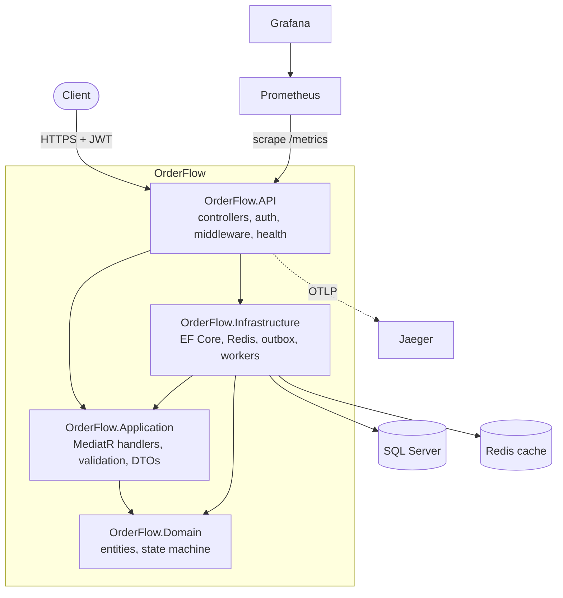
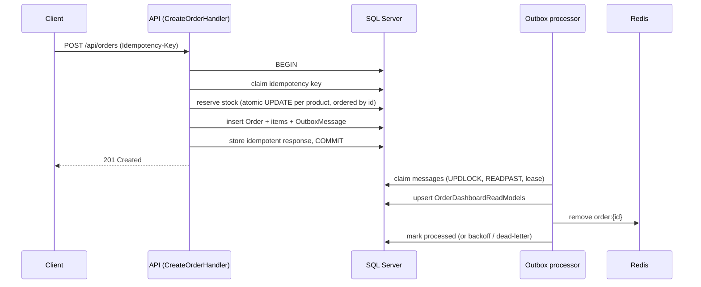
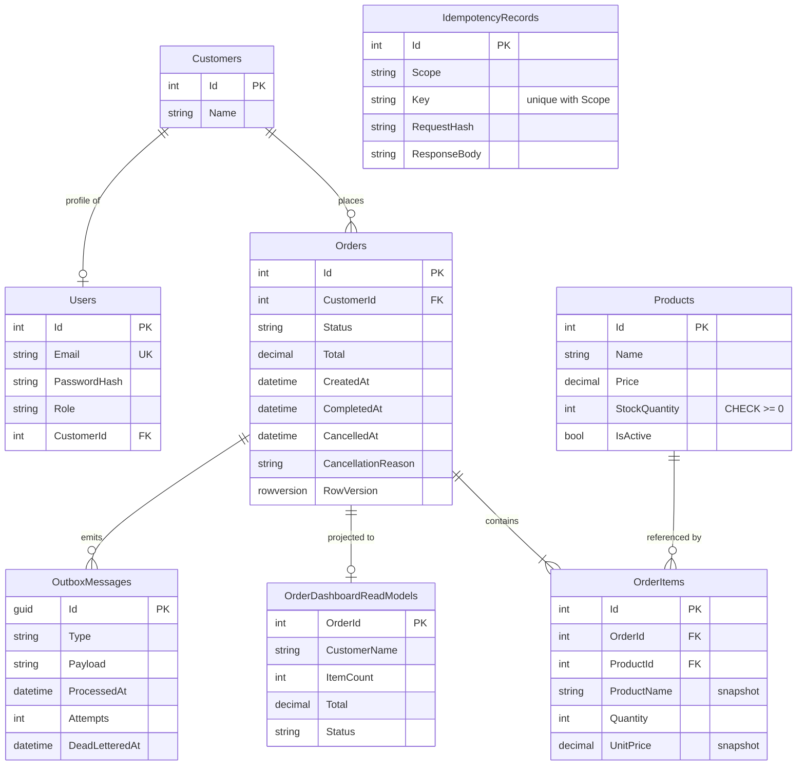
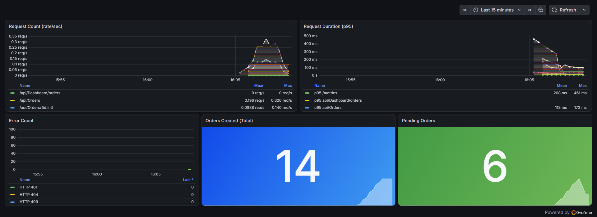
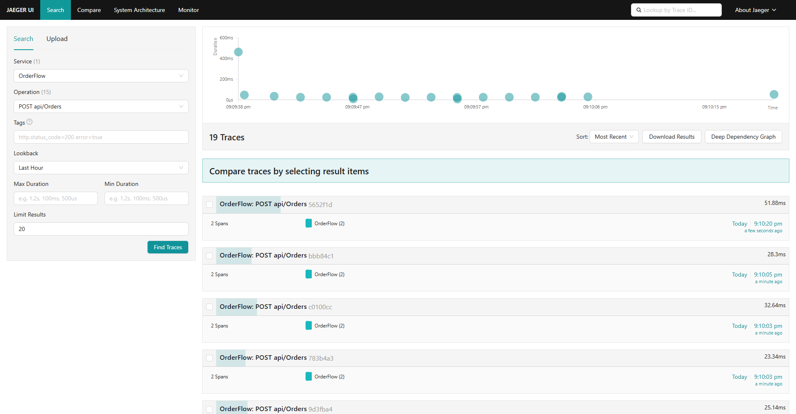
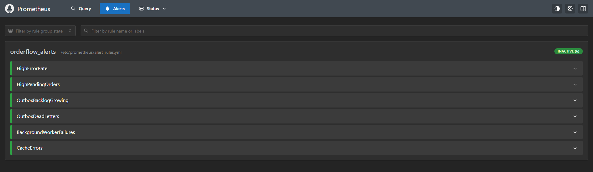
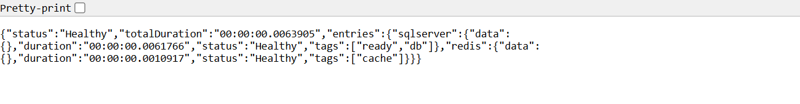
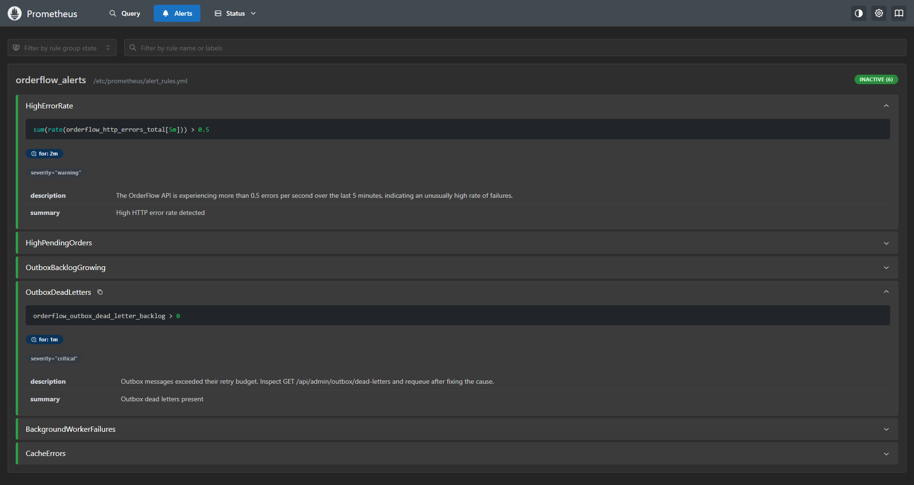

# OrderFlow — .NET 10 E-Commerce Order Backend

[](https://github.com/islamkhaled1/OrderFlow/actions/workflows/ci.yml)
[](https://dotnet.microsoft.com/)
[](https://learn.microsoft.com/ef/core/)
[](https://www.microsoft.com/sql-server)
[](https://redis.io/)
[](docker-compose.yml)
[](LICENSE)


OrderFlow is an order-management backend built with **ASP.NET Core (.NET 10)**, **EF Core 10 / SQL Server**, **Redis**, **MediatR (CQRS)** and **OpenTelemetry / Prometheus / Grafana / Jaeger**. The focus is **correct business logic**: stock can never be oversold, retried requests never create duplicate orders, order state changes follow an explicit state machine, and read models/caches are updated through a transactional outbox.

> The CI badge is generated live by GitHub from [.github/workflows/ci.yml](.github/workflows/ci.yml) and links to its [workflow runs](https://github.com/islamkhaled1/OrderFlow/actions/workflows/ci.yml). The other badges only describe the technologies and patterns used; they are not quality certifications. **Public deployment: pending** (run it locally with Docker Compose, see [Getting started](#7-getting-started)).

## Table of contents

1. [Features](#1-features)
2. [Architecture](#2-architecture)
3. [Data model (ERD)](#3-data-model-erd)
4. [Key design decisions](#4-key-design-decisions)
5. [Authentication & authorization](#5-authentication--authorization)
6. [API endpoints](#6-api-endpoints)
7. [Getting started](#7-getting-started)
8. [Configuration reference](#8-configuration-reference)
9. [Database migrations](#9-database-migrations)
10. [Testing & CI](#10-testing--ci)
11. [Observability](#11-observability)
12. [Load testing](#12-load-testing)
13. [Trade-offs & known limitations](#13-trade-offs--known-limitations)
14. [Contributing & license](#14-contributing--license)

---

## 1. Features

- **Inventory with atomic reservation** — `Products.StockQuantity` is decremented by a single conditional `UPDATE … WHERE StockQuantity >= @qty AND IsActive = 1`, backed by a `CHECK (StockQuantity >= 0)` constraint. Concurrent buyers cannot oversell.
- **Order lifecycle state machine** — `Pending → Completed` (admin) and `Pending → Cancelled` (owner/admin/expiry job). Invalid transitions return `409`. Cancelling releases the reserved stock exactly once.
- **Idempotent order creation** — optional `Idempotency-Key` header; same key + same payload replays the original response, same key + different payload returns `422`.
- **JWT authentication, role-based authorization** (`Customer`, `Admin`) with ownership checks. Customers get `404` for other customers' orders.
- **Transactional outbox** — order events are written in the same SQL transaction as the order; a background processor updates the dashboard read model and invalidates Redis with retries, exponential backoff and a dead-letter state (admin endpoint to inspect/requeue).
- **Paginated queries** (max page size 100), indexed for the access patterns; Redis cache-aside for order details with graceful fallback to SQL if Redis is down.
- **Observability** — OpenTelemetry traces + metrics, Prometheus alert rules, Grafana dashboard, split liveness/readiness health checks.
- **Tests** — unit tests plus integration tests running against a **real SQL Server** (no EF InMemory), including a 100-concurrent-requests-vs-limited-stock test.

## 2. Architecture



**Clean Architecture** defines the project layering: dependencies point inward and Domain has no external dependencies. **Vertical Slice Architecture** organises the code *inside* the Application layer: each use case (command/query, handler, validator, DTOs) lives together under `OrderFlow.Application/Features/*`. The two are complementary: slices sit within the Clean Architecture layers rather than replacing them.

**Create-order flow** (single SQL transaction):



## 3. Data model (ERD)



Order items snapshot the product name and unit price so historical orders never change when the catalog does. Legacy items created before inventory existed have `ProductId = NULL` and never release stock.

## 4. Key design decisions

| Topic | Decision | Why |
|---|---|---|
| Overselling | Atomic conditional `UPDATE` + `CHECK` constraint, lines merged per product and reserved in ascending product-id order | Correct under concurrency without long locks; consistent ordering avoids deadlocks |
| Reservation timing | Stock is reserved at order creation (status `Pending`) and released only on `Pending → Cancelled` | Customers can't check out stock that doesn't exist; a pending-order expiry job (default 60 min) frees abandoned reservations |
| Double release | State machine + `Orders.RowVersion` optimistic concurrency; release and status change in one transaction | Two concurrent cancels cannot both release stock |
| Completion | Explicit admin action (`POST /api/orders/{id}/complete`), no timer auto-completion | The previous timer silently completed every order, which is not a business rule |
| Idempotency | Claim key, create order, reserve stock, store response in **one transaction**; scoped per customer; 24h retention | A crash can't leave a key claimed without an order (or an order without a key). Failed attempts don't poison the key |
| Event delivery | Transactional outbox, at-least-once, idempotent handlers (dashboard recomputed from current state, cache removal) | No dual-write between SQL and Redis; duplicates are harmless |
| Dashboard | Incremental upsert per event; full rebuild only via admin endpoint | Replaces the old full-table refresh every 30s |
| Cache | Redis cache-aside for `GET /api/orders/{id}`; ownership is checked **after** the cache read; Redis failures are logged and counted, then fall back to SQL | Cache can never leak another customer's order |
| Errors | Only expected Redis exceptions are swallowed; cancellation and programming errors propagate | The old catch-all hid real bugs |

## 5. Authentication & authorization

- `POST /api/auth/register` creates a **Customer** (and its profile). Admins cannot self-register.
- `POST /api/auth/login` returns a signed JWT (`sub`, `role`, `customer_id`; default lifetime 60 minutes). Passwords are hashed with ASP.NET Core's `PasswordHasher`.
- An **Admin** is seeded at startup only if `Seed:AdminEmail` and `Seed:AdminPassword` are configured.
- The signing key is **never** stored in the repo: set `Jwt__SigningKey` (≥ 32 chars) via environment/user-secrets. The app refuses to start without it.
- Auth endpoints are rate limited (`RateLimiting:AuthPermitPerMinute`, default 10/min).
- Customers can only see/cancel their own orders; non-owners receive `404`. Admins can complete orders, read the dashboard and use the admin endpoints but cannot place orders (`403`).

## 6. API endpoints

Swagger UI is available at `/swagger`. All order endpoints require `Authorization: Bearer <token>`.

| Method & path | Role | Notes |
|---|---|---|
| `POST /api/auth/register` | anonymous | `{ email, password, name }` → `201` + token |
| `POST /api/auth/login` | anonymous | `{ email, password }` → `200` + token |
| `POST /api/orders` | Customer | Header `Idempotency-Key` (optional, ≤128 chars). `201`; replay adds `Idempotent-Replayed: true`. `409` insufficient stock, `422` key reused with different payload |
| `GET /api/orders/{id}` | owner / Admin | Cached; `404` for non-owner |
| `GET /api/orders` | Customer/Admin | Query: `page`, `pageSize` (≤100), `status`, `from`, `to`, `customerId`. Returns a paged result; customers only see their own |
| `POST /api/orders/{id}/cancel` | owner / Admin | `{ "reason": "…" }`; releases stock; `409` if not `Pending` |
| `POST /api/orders/{id}/complete` | Admin | `409` if not `Pending` |
| `GET /api/dashboard/orders` | Admin | Paged read model; eventually consistent |
| `GET /api/admin/outbox/dead-letters` | Admin | Inspect failed outbox messages |
| `POST /api/admin/outbox/dead-letters/{id}/requeue` | Admin | Retry a dead letter |
| `POST /api/admin/dashboard/rebuild` | Admin | Full read-model rebuild |
| `GET /health/live`, `/health/ready`, `/health` | anonymous | Liveness / readiness (SQL only) / detailed (Redis down = Degraded) |
| `GET /metrics` | anonymous | Prometheus scrape endpoint |

Error responses use RFC 7807 problem details with status mapping 400 (validation), 401, 403, 404, 409 (conflicts/insufficient stock/invalid transition/concurrency), 422 (idempotency payload mismatch) and 500 (no internal details leaked).

Example:

```bash
TOKEN=$(curl -s -X POST http://localhost:5138/api/auth/login \
  -H 'Content-Type: application/json' \
  -d '{"email":"demo@example.com","password":"Demo_Pass1!"}' | jq -r .accessToken)

curl -X POST http://localhost:5138/api/orders \
  -H "Authorization: Bearer $TOKEN" \
  -H 'Idempotency-Key: 11111111-1111-1111-1111-111111111111' \
  -H 'Content-Type: application/json' \
  -d '{"items":[{"productId":1,"quantity":2}]}'
```

A ready-made request collection is in [OrderFlow.API.http](src/OrderFlow.API/OrderFlow.API.http). The seeded demo catalog has product ids 1–5 with limited stock.

## 7. Getting started

**Prerequisites:** [.NET 10 SDK](https://dotnet.microsoft.com/download/dotnet/10.0), SQL Server (LocalDB, container or instance); Redis is optional (the API falls back to SQL).

### Option A — run the API locally

```bash
git clone https://github.com/islamkhaled1/OrderFlow.git
cd OrderFlow

# Required secrets (user-secrets keeps them out of git)
dotnet user-secrets set "Jwt:SigningKey" "<random string of at least 32 chars>" --project src/OrderFlow.API
# Optional: seed an admin
dotnet user-secrets set "Seed:AdminEmail" "admin@example.com" --project src/OrderFlow.API
dotnet user-secrets set "Seed:AdminPassword" "<strong password>" --project src/OrderFlow.API

dotnet run --project src/OrderFlow.API      # http://localhost:5138, swagger at /swagger
```

In `Development` the connection string targets `(localdb)\MSSQLLocalDB`. Migrations are applied automatically on startup (`Database:AutoMigrate`, default `true`).

### Option B — Docker Compose (API + SQL Server + Redis + Prometheus + Grafana + Jaeger)

```bash
cp .env.example .env      # then edit every placeholder
docker compose up -d --build
```

| Service | URL |
|---|---|
| API / Swagger | http://localhost:8080 , http://localhost:8080/swagger |
| Prometheus | http://localhost:9090 |
| Grafana | http://localhost:3000 (credentials from `.env`) |
| Jaeger | http://localhost:16686 |

Compose refuses to start if `MSSQL_SA_PASSWORD`, `JWT_SIGNING_KEY` or `GRAFANA_ADMIN_PASSWORD` are missing — there are no default secrets in the repo.

> **Verification status (2026-10-24, Docker Desktop on Windows):** `docker compose config -q` and `docker compose up -d --build` succeeded and all six services came up (SQL Server and Redis healthy). Observed: `/health/live` and `/health/ready` return 200 and `/health` reports `sqlserver` and `redis` Healthy; both migrations applied on startup and seed data/admin were created; register → create order → idempotent replay (same order id) → get order → anonymous 401 behaved as documented; Prometheus target `orderflow-api` is `up`, all 6 alert rules load with health `ok`, and `orderflow_orders_created_total` reflected the new order; Grafana has the provisioned `Prometheus` datasource and `OrderFlow Dashboard`; Jaeger has the `OrderFlow` service with traces for HTTP, `CreateOrder` and `GetOrderById` spans. Not covered: alert firing (rules were verified as loaded and inactive).
>
> **Troubleshooting:**
> - *Name conflict* (`container name "/orderflow-prometheus" is already in use`): the compose file uses fixed `container_name`s and an older stack under another project name can hold them. Check `docker ps -a --filter name=orderflow-` and remove only the stale OrderFlow containers, or run `docker compose down` in the project that owns them.
> - *Redis unhealthy with `Can't handle RDB format version 15`*: a persisted `redis-data` volume was written by a newer Redis than the pinned `redis:7-alpine`. Redis only holds cache data, so `docker compose down && docker volume rm <project>_redis-data` fixes it.
> - *Port clash*: set `API_HOST_PORT` in `.env` (the stack above ran with `18080`).

## 8. Configuration reference

Nested keys map to environment variables with `__` (e.g. `Jwt:SigningKey` → `Jwt__SigningKey`).

| Key | Default | Description |
|---|---|---|
| `ConnectionStrings:DefaultConnection` | placeholder | SQL Server connection string |
| `Redis:ConnectionString` | `localhost:6379,abortConnect=false` | Redis (500 ms timeouts) |
| `Jwt:SigningKey` | **required** | ≥ 32 chars; never commit |
| `Jwt:Issuer` / `Jwt:Audience` / `Jwt:AccessTokenMinutes` | `OrderFlow` / `OrderFlow.Clients` / `60` | Token settings |
| `Seed:AdminEmail` / `Seed:AdminPassword` | unset | Seeds an Admin when both set |
| `Caching:OrderDetailsExpirationMinutes` | `5` | Order cache TTL |
| `BackgroundJobs:IntervalSeconds` | `60` | Maintenance worker interval |
| `BackgroundJobs:PendingOrderExpirationMinutes` | `60` | Cancel pending orders older than this |
| `BackgroundJobs:ExpirationBatchSize` | `100` | Orders expired per cycle |
| `Outbox:*` | see `OutboxOptions` | Poll interval, batch size, lease, max attempts (8) |
| `Idempotency:RetentionHours` | `24` | Key retention |
| `RateLimiting:AuthPermitPerMinute` | `10` | Auth endpoint limit |
| `Database:AutoMigrate` | `true` | Apply migrations on startup |
| `OpenTelemetry:OtlpEndpoint` | `http://localhost:4317` | Empty disables OTLP export |
| `OpenTelemetry:ConsoleExporter` | `false` | Trace console exporter |
| `ORDERFLOW_TEST_SQL` (tests only) | LocalDB | Server-level SQL connection string for integration tests |

## 9. Database migrations

```bash
dotnet ef database update --project src/OrderFlow.Infrastructure --startup-project src/OrderFlow.API
dotnet ef migrations add <Name> --project src/OrderFlow.Infrastructure --startup-project src/OrderFlow.API
```

- `InitialCreate` is untouched.
- `*_InventoryAuthOutboxIdempotency` adds stock/`IsActive`, order lifecycle columns and `RowVersion`, `Users`, `OutboxMessages`, `IdempotencyRecords`, constraints and indexes. Existing products are initialised with `StockQuantity = 100`; existing orders keep their data (legacy order items have a `NULL` `ProductId`).
- An integration test fails if the EF model has pending changes without a migration.

## 10. Testing & CI

```bash
dotnet test OrderFlow.sln -c Release
```

Integration tests use a **real SQL Server** and create/drop a database per test class. Locally they use LocalDB by default; set `ORDERFLOW_TEST_SQL` (e.g. `Server=localhost,1433;User Id=sa;Password=...;TrustServerCertificate=True`) to use another server. API-level tests use an in-memory cache double with failure injection. The real `RedisCacheService` has its own tests (`RedisCacheServiceRealRedisTests`) that run **only when `ORDERFLOW_TEST_REDIS` is set** and are reported as skipped otherwise:

```bash
docker run -d --name orderflow-test-redis -p 6379:6379 redis:7
ORDERFLOW_TEST_REDIS=localhost:6379 dotnet test OrderFlow.sln -c Release   # PowerShell: $env:ORDERFLOW_TEST_REDIS='localhost:6379'
```

Latest local run (Windows, .NET 10 SDK, LocalDB):

```text
Passed!  - Failed: 0, Passed: 68, Skipped: 0, Total: 68 - OrderFlow.UnitTests.dll
Passed!  - Failed: 0, Passed: 57, Skipped: 4, Total: 61 - OrderFlow.IntegrationTests.dll
```

The 4 skipped tests are the real-Redis tests. With `ORDERFLOW_TEST_REDIS=localhost:6379` pointed at the compose Redis they were run separately and **all 4 passed** (`dotnet test --filter FullyQualifiedName~RedisCacheService`: 12/12 unit, 4/4 integration).

Covered scenarios include: 100 concurrent orders against stock of 10 (exactly 10 succeed, stock ends at 0, never negative), concurrent same-key idempotent requests (one order), double-cancel releases stock once, cancel vs. complete races, invalid transitions, authentication/authorization and ownership rules, outbox processing/retry/dead-letter, cache hit/miss/Redis-down fallback, pagination bounds and migration/model consistency.

The GitHub Actions workflow ([ci.yml](.github/workflows/ci.yml)) restores, checks formatting, builds in Release, runs all tests against a SQL Server 2022 service container and lists vulnerable packages. The latest run on `main` (commit `c461266`, after the line-ending fix) completed successfully; the live badge above always shows the current result.

## 11. Observability

- **Metrics** (`/metrics`): HTTP request/error counters and duration histogram, `orderflow_orders_created_total`, `orderflow_orders_pending`, idempotency replays, order transitions, `orderflow_outbox_pending`, `orderflow_outbox_dead_letter_backlog`, `orderflow_outbox_processed_total` / `failed` / `dead_lettered`, `orderflow_cache_hits_total` / `misses` / `errors`, `orderflow_worker_failures_total`, `orderflow_orders_expired_total`.
- **Tracing**: OpenTelemetry (ASP.NET Core + custom `OrderFlow` and `OrderFlow.Background` sources) exported to Jaeger via OTLP.
- **Alerts** ([alert_rules.yml](monitoring/prometheus/alert_rules.yml)): `HighErrorRate`, `HighPendingOrders`, `OutboxBacklogGrowing`, `OutboxDeadLetters`, `BackgroundWorkerFailures`, `CacheErrors`.
- **Health**: `/health/live` (process), `/health/ready` (SQL Server), `/health` (details redacted, Redis down reports `Degraded`).

Screenshots `01`–`03` in `submission/screenshots/` (captured 2026-09-27) predate the inventory/auth/outbox work and are **outdated legacy images**; they are kept only because [submission/VERIFICATION.md](submission/VERIFICATION.md) (which also describes that earlier version) refers to them, and are not embedded here. The current images were captured from the live local stack with headless Chrome and show **local demo traffic** (a few dozen real API requests after resetting the disposable demo volumes), not production data: `v2-grafana-dashboard.png` (kiosk mode, 15 min window; 14 orders created, 6 pending), `v2-jaeger-traces.png` (Jaeger search for `POST api/Orders`: 19 recent traces, each with an HTTP span and a `CreateOrder` span) and `v2-prometheus-alerts.png` (the six rules in `alert_rules.yml`, all loaded with health `ok` and state **inactive** — no alert fired).





`04-health-check.png` and `05-alerts.png` were also re-captured from the running local stack (2026-10-25). `04-health-check.png` is the raw response of `GET /health` (observed HTTP 200, `sqlserver` and `redis` both `Healthy`; `/health/live` and `/health/ready` also returned 200). `05-alerts.png` is the Prometheus Alerts page with `HighErrorRate` and `OutboxDeadLetters` expanded to show their expressions, `for` durations and severities; all six rules were `inactive` with health `ok`, so no alert fired.




## 12. Load testing

[loadtests/orders.js](loadtests/orders.js) registers one k6 customer in `setup()` (`POST /api/auth/register` → `/api/auth/login`, shared token because auth endpoints are rate limited to `RateLimiting:AuthPermitPerMinute`, default 10/min), creates one seed order with an `Idempotency-Key`, then runs two concurrent scenarios: `reads` (`VUS` VUs, `GET /api/orders/{id}` on the seed order, i.e. the cache-aside path) and `creates` (`VUS/5` VUs, `POST /api/orders` for 1 unit of `PRODUCT_ID`; `409` stock conflicts are accepted). Thresholds: read failure rate < 1 %, read p95 < 500 ms.

**Prerequisites:** [k6](https://grafana.com/docs/k6/latest/set-up/install-k6/) (`winget install k6`, `brew install k6`, or run `grafana/k6` in Docker), a running API with a reachable SQL Server (and Redis for the cached path), and enough stock in the target product. Seeded product `4` (USB-C adapter) has only 200 units, so for a sustained run restock it first (**dev databases only**):

```sql
UPDATE Products SET StockQuantity = 1000000;
```

```bash
# Local API (dotnet run → http://localhost:5138) or compose (http://localhost:8080)
k6 run -e BASE_URL=http://localhost:8080 -e VUS=10 -e DURATION=30s -e PRODUCT_ID=4 loadtests/orders.js

# Without a local k6 install (Docker Desktop; use host.docker.internal to reach a host-published API)
docker run --rm -v "${PWD}/loadtests:/scripts" -e BASE_URL=http://host.docker.internal:8080 grafana/k6 run /scripts/orders.js
```

Environment variables: `BASE_URL` (default `http://localhost:8080`), `VUS` (10), `DURATION` (`30s`), `PRODUCT_ID` (4).

**Cache comparison:** run the identical command twice — once with Redis running and once after `docker stop orderflow-redis` — on the same machine, same data and no other load; [loadtests/compare-cache.ps1](loadtests/compare-cache.ps1) automates this for a compose stack (set `SA_PASSWORD` and optionally `COMPOSE_NETWORK`).

### Measured results (local test results, 2026-10-24, one Windows dev machine)

Produced by `loadtests/compare-cache.ps1` against the compose stack (API, SQL Server, Redis in Docker Desktop; k6 in Docker on the compose network), 10 read VUs + 2 create VUs, 20 s, product 4 restocked to 1,000,000, raw output in `loadtests/k6-redis-up.txt` / `k6-redis-down.txt`:

| | Redis up | Redis stopped (SQL fallback) |
|---|---|---|
| Total throughput (reads + creates) | 3,702.8 req/s | 1,931.8 req/s |
| `http_req_duration` p95 | 4.77 ms | 9.43 ms |
| Read p95 (`order_read_ms`) | 4.44 ms | 8.58 ms |
| Create p95 (`order_create_ms`) | 61.33 ms | 76.38 ms |
| Failed requests / checks | 0 / 75,787 · 0 failed checks | 0 / 39,322 · 0 failed checks |

Caveats: a single run per condition (no repetitions or variance), one hot order read repeatedly, client, API and database sharing one machine, so these numbers show the relative cache effect on this hardware, not production capacity. Throughput is dominated by the read scenario, so the creates-per-second figure is lower than the total.

## 13. Trade-offs & known limitations

- Single `StockQuantity` per product (no warehouses, no separate reserved/available split, no stock history ledger).
- Reservation at order creation means unpaid `Pending` orders hold stock until completed/cancelled/expired; there is no payment integration.
- The dashboard read model and cache invalidation are **eventually consistent** (outbox poll interval, default ~2 s). Money values use `decimal`; single currency.
- The outbox runs inside the API process (no separate worker or broker). It is at-least-once; multiple API instances are safe thanks to row-level claiming, but throughput is bounded by SQL polling. Moving to a broker (e.g. RabbitMQ/Kafka) would be the next step for scale.
- Auth is a lean `Users` table + JWT: no refresh tokens, token revocation, email confirmation or password reset; access tokens are valid until expiry.
- Order cache holds data for up to the TTL if the outbox invalidation is delayed.
- Product management endpoints are not implemented (catalog is seeded).
- Not done: a public deployment (no hosted Swagger URL yet), alert-firing drills and benchmark repetitions. This project is a portfolio demonstration and is **not** claimed to be production ready. Tests use LocalDB locally rather than Testcontainers.

## 14. Contributing & license

See [CONTRIBUTING.md](CONTRIBUTING.md). Licensed under the [MIT License](LICENSE).
